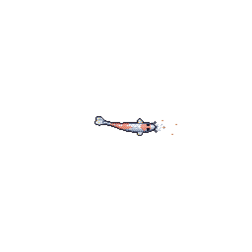

# 💫 About Me:
📊 I'm currently working on ResearchMate, an AI Powered research assistant system.  🌱 I'm currently learning Python, Data Analytics, and exploring the world of AI & Machine Learning.  🤝 I'm looking to collaborate on Data Analytics and Python projects.  💡 I'm interested in turning raw data into meaningful insights.  💬 Ask me about my projects and learning journey.  ⚡ Fun fact: I believe every dataset has a story waiting to be discovered.

## 🌐 Socials:
    

# 💻 Tech Stack:
                                      
# 📊 GitHub Stats:
 
 

### ✍️ Random Dev Quote

### 🔝 Top Contributed Repo

---

<!-- Proudly created with GPRM ( https://gprm.itsvg.in ) -->

---

## 🌊 UNDERWATER ACTIVITY

<picture>
  <source media="(prefers-color-scheme: dark)" srcset="https://raw.githubusercontent.com/Taiyab2002/Taiyab2002/output/github-snake-dark.svg">
  <source media="(prefers-color-scheme: light)" srcset="https://raw.githubusercontent.com/Taiyab2002/Taiyab2002/output/github-snake.svg">
  
</picture>

  

