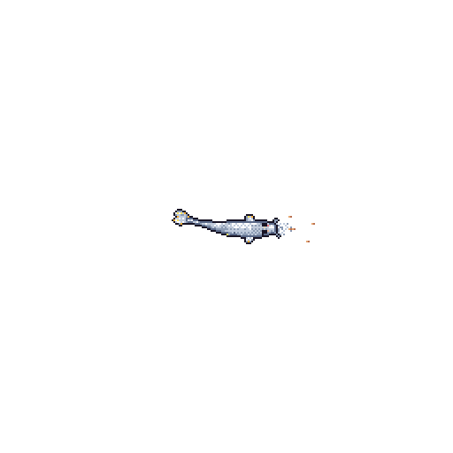

# 💫 About Me

<h3 align="center">
  
</h3>

  🎓 Computer Science and Engineering Student at Metropolitan University, Bangladesh 
  🤖 Aspiring Machine Learning & Generative AI Engineer 
  🌱 Building foundations in Python, Mathematics, Statistics & Machine Learning 
  🧠 Exploring LLMs, RAG, Vector Databases & AI Agents 
  🚀 Contributing to the frontend development of <b>ResearchMate</b> (In Progress) 
  ⚡ Learning, experimenting and building practical solutions.

---

## 🌐 Connect With Me

  
  
  
  

---

## 🎯 Career Focus

My primary areas of career interest are:

- **Machine Learning Engineering** — Understanding, developing and applying machine learning models to real-world problems.
- **Generative AI Engineering** — Exploring LLM-powered applications, RAG pipelines and AI-driven systems.

I am focused on developing strong fundamentals before moving toward more advanced applications and engineering practices.

---

## 💻 Tech Stack & Learning

  
  
  
  
  
  
  
  
  

---

## 🧭 Learning Roadmap

My learning journey is focused on building a strong foundation and gradually progressing toward Machine Learning and Generative AI Engineering.

**01. Core Foundations**
- Python Programming
- Mathematics & Statistics
- Data Structures & Algorithms
- SQL & Data Analysis
- Git & GitHub

**02. Machine Learning**
- Machine Learning Fundamentals
- Data Preprocessing & Feature Engineering
- Supervised & Unsupervised Learning
- Model Evaluation & Optimization
- Deep Learning Fundamentals

**03. Generative AI & LLM Engineering**
- Generative AI Fundamentals
- Large Language Models (LLMs)
- Prompt Engineering
- Retrieval-Augmented Generation (RAG)
- Embeddings & Vector Databases
- AI Agents

**04. AI Application Engineering**
- Backend Development & APIs
- Model Integration
- Deployment & Production Fundamentals

---

## 🚀 Projects

| Project | Description | Status |
|---|---|---|
| [ResearchMate](https://github.com/Taiyab2002/ResearchMate) | An AI-powered academic research assistance platform for students and researchers. | In Progress |
| [Portfolio](https://github.com/Taiyab2002/portfolio) | My personal portfolio showcasing my background, learning journey and projects. | Ongoing |
| [Compiler Construction](https://github.com/Taiyab2002/compiler-construction) | An academic project focused on compiler construction. | Project |

---

## 🏆 Certifications

- **Kaggle** — Intro to Machine Learning
- **Ostad** — AI Automation for Work and Business

---

## 📊 GitHub Statistics

   
   
  

---

### ✍️ Random Dev Quote

  

### 🔝 Top Contributed Repository

  

---

  

---

## 🌊 UNDERWATER ACTIVITY

  <picture>
    <source media="(prefers-color-scheme: dark)" srcset="https://raw.githubusercontent.com/Taiyab2002/Taiyab2002/output/github-snake-dark.svg">
    <source media="(prefers-color-scheme: light)" srcset="https://raw.githubusercontent.com/Taiyab2002/Taiyab2002/output/github-snake.svg">
    
  </picture>

  

---

  <i>"Curiosity is my learning path. Consistency is how I move forward."</i>

